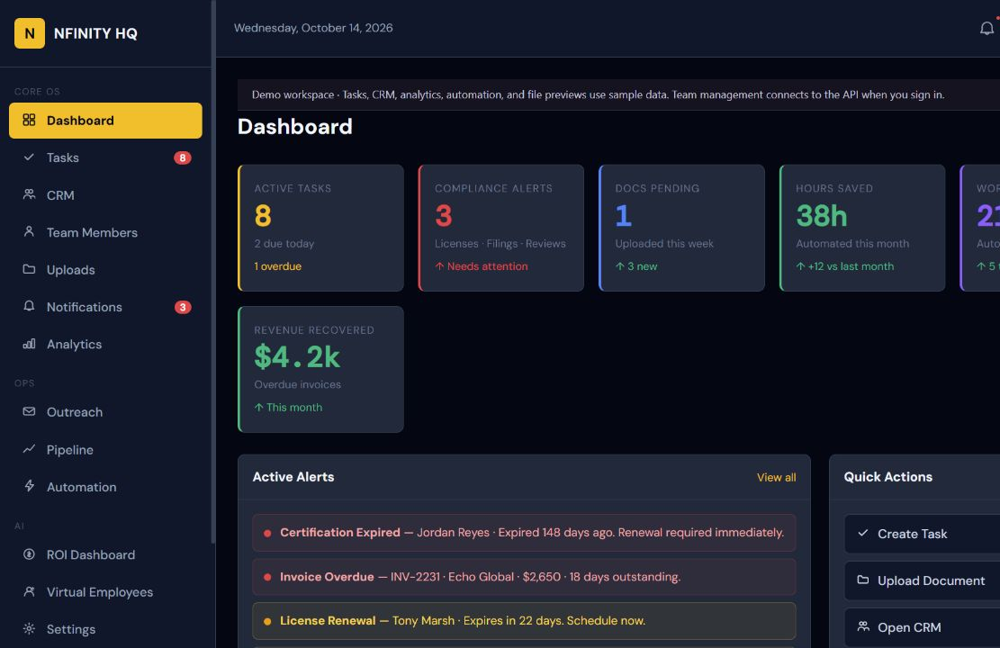
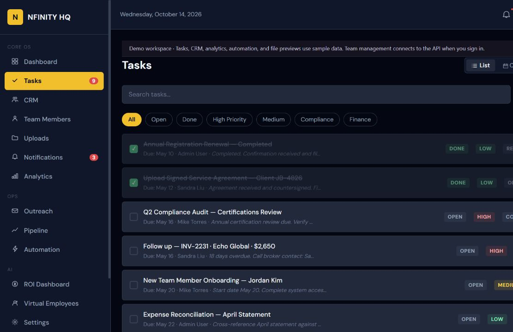

# NfinityHQ

I built NfinityHQ as a client portal and business operations demo. The Express API handles accounts, teams, lead capture, password resets, and uploads. The workspace also includes interactive demo features, which are listed below.

The frontend and backend stay separate in one repository. Browser assets have one home under `frontend/`; the backend serves those assets during local development. The frontend can also build a static artifact for separate hosting.



## Stack and why I used it

| Part | Technology | Reason |
| --- | --- | --- |
| Pages and workspace | HTML, CSS, vanilla JavaScript | Keeps the active frontend simple to serve and build as static files. |
| API | Node.js, Express | Uses JavaScript on both sides and keeps routes easy to follow. |
| Passwords and sessions | bcryptjs, JSON Web Tokens | Hashes account passwords and checks signed sessions on protected routes. |
| Local configuration | dotenv, environment variables | Keeps deployment secrets outside the source. |
| Data | Local JSON files | Makes this version easy to run on one server without a database service. |
| Email | Resend API | Sends invitations, password resets, and lead notifications. |
| Alerts | Telegram Bot API | Sends optional lead notifications to a private chat. |
| Files | Multer, AWS SDK for JavaScript, Amazon S3 API | Validates uploads and supports local development storage or production object storage. |
| Builds and tests | Node scripts, Node's test runner | Builds the static frontend and tests API/storage behavior without another framework. |

The main languages are JavaScript, HTML, and CSS. JSON stores configuration and local records. Older JSX prototypes remain as references; the active frontend does not require React. JSON storage suits a small single-process version, but a shared production service would need a database and stronger session handling.

The browser calls the Express API over HTTP locally or HTTPS when deployed. Resend, Telegram, and S3 calls stay on the backend. Only the public API origin is sent to the browser; keys, signing secrets, account stores, and uploads stay private. See the [API README](backend/README.md) for routes and [environment example](backend/.env.example) for configuration names.

## Working features and demo features

| Area | Current behavior |
| --- | --- |
| Login | Authenticates onboarded server accounts and returns a JWT |
| Team members | Uses the API with a real session; guests use a browser-local demonstration team |
| Password reset and invites | Backend flows use Resend when configured |
| Lead capture | Saves leads locally; optional Resend and Telegram notifications |
| Upload API | Saves bytes locally in development and to S3 in production |
| Tasks and file previews | Browser-local demonstration records; previews do not download real files |
| CRM, outreach, pipeline | Interactive sample workflows; changes are not a shared server workspace |
| Analytics, ROI, automation, virtual employees | Simulated activity and demonstration metrics |

The guest demo is intentionally public. It does not grant backend permissions. The demo upload screen currently manages file metadata; it is not wired to the upload API. Production accounts are created manually, not through public signup.

## Start locally

Use Node.js 22 or newer. Node 24 was used for verification.

```powershell
npm ci --prefix backend
Copy-Item backend/.env.example backend/.env
npm start
```

Open `http://127.0.0.1:3000` for the homepage or `http://127.0.0.1:3000/apps/demo/` for the guest workspace. External credentials are optional for these local flows. Logs explain which notification services are unconfigured. Real email, Telegram delivery, and S3 uploads require their own configuration.

For an account in your local development store:

```powershell
cd backend
npm run client:create
```

The onboarding command creates a company owner or admin, hashes its temporary password, and prints the password once. Team members can then be added from the signed-in workspace. No existing users or customer records ship with the source.

## Frontend build and split hosting

```powershell
npm ci --prefix frontend
$env:NFINITY_API_BASE_URL = "http://127.0.0.1:3000"
npm run build
npm run preview
```

The static preview runs at `http://127.0.0.1:4173`. Allow that origin in the backend's `ALLOWED_ORIGINS`. The build copies browser assets into `frontend/dist`, writes a public API origin into runtime configuration, and updates the page connection policy. It does not copy backend code, customer stores, or environment files.

For a deployment build, set `NFINITY_API_BASE_URL` to the backend's HTTPS origin. Production/CI builds require that variable. Only loopback origins may use HTTP. Runtime configuration contains a public URL, never an API credential.

## Configuration

See [backend/.env.example](backend/.env.example) for the supported values.

| Values | Purpose |
| --- | --- |
| `NODE_ENV`, `PORT`, `HOST` | Runtime mode and listener; local development defaults to loopback |
| `JWT_SECRET`, `SESSION_TTL` | Session signing and lifetime; production requires a random secret of at least 32 characters |
| `APP_URL`, `APP_BASE_URL` | Frontend page base used in invitation and reset links; include `/public` for the local server |
| `ALLOWED_ORIGINS` | Browser origins allowed to call the API |
| `RESEND_API_KEY`, `RESEND_FROM_EMAIL`, `ADMIN_EMAIL` | Transactional and lead email |
| `TELEGRAM_BOT_TOKEN`, `TELEGRAM_CHAT_ID` | Optional lead alerts |
| `AWS_REGION`, `S3_BUCKET_NAME`, `S3_PUBLIC_BASE_URL` | Production upload storage; credentials come from the SDK's provider chain |
| `USERS_FILE`, `LEADS_FILE`, `FILES_FILE`, `RESET_TOKENS_FILE`, `AUDIT_FILE`, `UPLOAD_DIR` | Optional persistent storage locations |

Development sessions use a temporary random secret when none is configured, so restarting the server invalidates those sessions. The frontend retains the existing localStorage bearer-token format. This is a known deployment limitation; it is not an HttpOnly-cookie session implementation.

## Architecture

```text
frontend/
  public/             Marketing, login, reset pages, shared UI behavior
  apps/demo/          Workspace HTML, demo.js, demo.css, preserved prototypes
  core/               Browser API client and automation scenarios
  client_configs/     Demonstration branding and module configuration
  scripts/            Static build and preview server
backend/
  server.js           Express setup, static serving, errors, shutdown
  api/                Auth, team, leads, uploads
  core/auth/          Accounts, password hashing, sessions, reset tokens, audit
  core/storage/       Local stores and atomic JSON replacement
  core/uploads/       Upload validation and local/S3 storage
  scripts/            Manual company onboarding
tests/                API and storage regression tests
scripts/              Source syntax check
```

The active interface uses HTML, CSS, and vanilla JavaScript. Older JSX prototypes are retained as references and are not a React build dependency. The API uses Express 4, bcryptjs, jsonwebtoken, Multer, Resend, and the AWS S3 SDK.

A login request returns a signed token. Team requests send that token as a Bearer header; the server reloads the account and checks company and role before changing data. Lead submissions validate and save their payload before optional delivery. The upload route validates a multipart file and saves metadata separately from its bytes.

Accounts, leads, file metadata, audit records, and reset tokens use JSON files in this version. Account, reset, lead, and file writes use atomic replacement, and corrupt stores are not silently reset. This is a single-process storage design, not a PostgreSQL implementation. Persistent disk and backups are required; multiple server instances can overwrite each other's JSON changes. Do not use ephemeral deployment storage for real accounts.

## Verification

```powershell
npm run check
npm test
npm run build
npm audit --prefix backend
```

The source check parses JavaScript files and inline page scripts. API tests use temporary users and files, covering login, team isolation, disabled accounts, uploads, private-file access, and malformed bodies. Storage tests cover replacement and corrupt data. Browser checks cover task creation, section navigation, modal behavior, and a 390px layout. External email delivery, Telegram messages, AWS deployment, and S3 production uploads have not been exercised with live credentials.



## Deployment notes

Keep the API and frontend directories together when deploying the integrated server. For a static frontend, publish only `frontend/dist`. See [frontend deployment](frontend/docs/AMPLIFY_LAUNCH.md), [backend deployment](backend/docs/ELASTIC_BEANSTALK_LAUNCH.md), and [onboarding](backend/docs/FIRST_CLIENT_ONBOARDING.md).

Browse the application source directly in [`frontend/`](frontend/) and [`backend/`](backend/). Environment files, user stores, uploads, dependency folders, old archives, and local tool settings are excluded from the published source.

The source retains its existing unlicensed status. No open-source license has been inferred or added.
